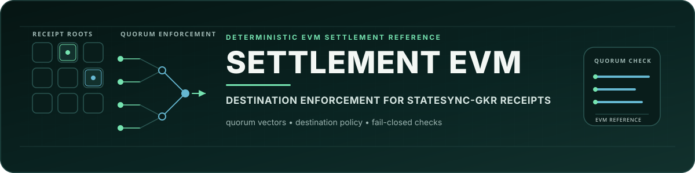
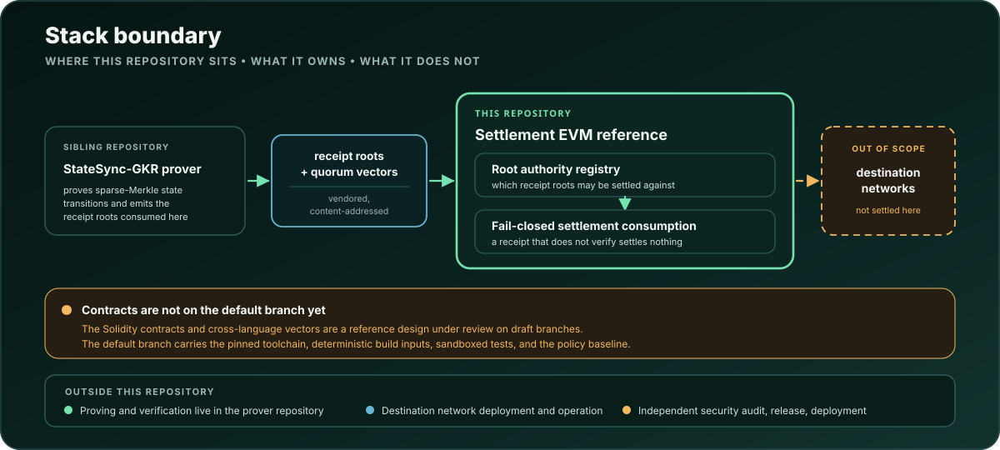

<p align="center">
  <picture>
    <source media="(max-width: 900px)" srcset="assets/brand/statesync-gkr-settlement-hero-mobile.svg">
    
  </picture>
</p>

<p align="center">
  <a href="https://github.com/Oraclizer/statesync-gkr-settlement-evm/actions/workflows/ci.yml"></a>
  <a href="https://github.com/Oraclizer/statesync-gkr-settlement-evm/actions/workflows/ci.yml"></a>
  <a href="LICENSE-APACHE"></a>
</p>

# StateSync-GKR Settlement EVM

A deterministic EVM reference for destination receipt-root enforcement in the
StateSync-GKR stack, built with Foundry on a fully pinned toolchain.

> **Pre-deployment baseline.** The repository establishes its build, security,
> and contribution boundaries before contract implementation lands; see
> [`DISCLAIMER.md`](DISCLAIMER.md) for the exact non-claims.

## Part of the StateSync-GKR stack

The [StateSync-GKR prover](https://github.com/Oraclizer/statesync-gkr) proves
sparse-Merkle state transitions and emits receipt roots. This repository is
where those receipt roots meet the EVM: settlement contracts that enforce
destination policy against quorum vectors produced by the prover, failing
closed when a receipt does not verify. The prover repository owns proving and
verification; this repository owns on-chain enforcement.

## Current status

| Area | Status |
| --- | --- |
| Repository policy and Continuous Integration baseline | Present |
| Fully pinned toolchain (Foundry commit, solc build hash, EVM target, optimizer, seeds) | Present |
| External Solidity dependencies | Zero: no forge-std, no `lib/`, no submodules |
| Deterministic bytecode inputs (`bytecode_hash = "none"`, no CBOR metadata) | Present |
| Sandboxed tests (FFI disabled, empty filesystem permissions, script execution protection) | Present |
| Warnings promoted to errors | Present |
| Solidity contracts and cross-language vectors | Land through reviewed pull requests; not yet on the default branch |
| Independent security audit, release, deployment | Not yet |

Passing Continuous Integration at this stage shows that the policy baseline is
well formed under the pinned toolchain; contract-level assurance arrives with
the contracts themselves.

## Quick start

Use Foundry `1.7.1` built from commit
`4072e48705af9d93e3c0f6e29e93b5e9a40caed8`, and the exact Solidity `0.8.36`
compiler. `foundry.toml` runs offline with auto-detection disabled, so fetch
the compiler once and verify it, exactly as CI does:

```sh
curl --fail --location --proto '=https' --tlsv1.2 \
  --output solc-0.8.36 \
  'https://binaries.soliditylang.org/linux-amd64/solc-linux-amd64-v0.8.36+commit.8a079791'
printf 'c8d35afdddc3cd2743ee88b8f25e0fecd16e2bdd5f2120f37e52cd9cc45ae0e6  solc-0.8.36\n' | sha256sum --check --strict
chmod 0755 solc-0.8.36
```

On macOS or Windows, download the matching platform build for
`v0.8.36+commit.8a079791` from the same official
`binaries.soliditylang.org` index and verify its published checksum, or run
`svm install 0.8.36` if you use svm.

Then run the same checks CI runs:

```sh
forge --version
forge fmt --check
forge build --offline --use ./solc-0.8.36
forge test --offline --use ./solc-0.8.36 --fuzz-seed 0x000102030405060708090a0b0c0d0e0f101112131415161718191a1b1c1d1e1f
```

The expected `forge --version` output contains both:

```text
forge Version: 1.7.1
Commit SHA: 4072e48705af9d93e3c0f6e29e93b5e9a40caed8
```

These commands require no RPC endpoint, fork, wallet, signature, broadcast, or
deployment.

## Pinned build profile

| Setting | Value |
| --- | --- |
| Foundry | `1.7.1` / `4072e48705af9d93e3c0f6e29e93b5e9a40caed8` |
| Solidity | `0.8.36+commit.8a079791`, auto-detection disabled, checksum-verified |
| EVM target | `cancun` |
| Optimizer | enabled, 200 runs |
| Fuzzing | 1,024 runs with the checked-in 32-byte seed |
| Invariants | 256 runs, depth 128, same deterministic test-runner seed |
| FFI | disabled |
| Compiler metadata hash | disabled for deterministic bytecode inputs |

`cancun` is selected instead of a newer default so future artifacts do not
silently depend on Prague or Osaka opcodes before a destination network profile
is explicitly reviewed. A later target change must be treated as a compatibility
and bytecode-identity change.

Foundry 1.7.1 exposes the deterministic runner seed through `fuzz.seed` and the
`--fuzz-seed` flag. The invariant run count and depth are separately pinned in
`foundry.toml`; Continuous Integration supplies the same runner seed explicitly.

## Repository map

- [`foundry.toml`](foundry.toml): compiler, EVM, optimizer, fuzz, invariant,
  formatting, and sandbox settings.
- [`.github/workflows/ci.yml`](.github/workflows/ci.yml): least-privilege,
  immutable-action Continuous Integration with a checksum-verified compiler.
- [`SECURITY.md`](SECURITY.md): private vulnerability reporting and the current
  support boundary.
- [`CONTRIBUTING.md`](CONTRIBUTING.md): contribution and validation rules.
- [`GOVERNANCE.md`](GOVERNANCE.md): review, merge, release, and authority rules.
- [`SUPPORT.md`](SUPPORT.md): support scope and routing.
- [`DISCLAIMER.md`](DISCLAIMER.md): plain-language non-claims.
- [`CHANGELOG.md`](CHANGELOG.md): user-relevant repository changes.

## Where this repository sits

<p align="center">
  <picture>
    <source media="(max-width: 900px)" srcset="assets/diagrams/settlement-stack-boundary-mobile.svg">
    
  </picture>
</p>

A contract-level architecture diagram lands together with the first contracts
on the default branch; it will describe actual state ownership, trust
boundaries, and fail-closed paths rather than anticipate code that has not
merged.

## Security

Report suspected vulnerabilities privately following
[`SECURITY.md`](SECURITY.md): email `security@oraclizer.io`, never a public
issue. Source review, tests, fuzzing, invariants, cross-language vectors,
independent audits, compiler output review, and deployed-bytecode verification
are distinct assurance layers, and each is claimed only where its evidence
exists.

## Contributing, governance, and support

Read [`CONTRIBUTING.md`](CONTRIBUTING.md) before proposing a change. Project
decisions and merge authority are described in [`GOVERNANCE.md`](GOVERNANCE.md).
General support boundaries are in [`SUPPORT.md`](SUPPORT.md), and all
participation is governed by [`CODE_OF_CONDUCT.md`](CODE_OF_CONDUCT.md).

## License

Licensed under either the Apache License, Version 2.0 or the MIT License, at your
option. See [`LICENSE-APACHE`](LICENSE-APACHE) and [`LICENSE-MIT`](LICENSE-MIT).

This README and [`DISCLAIMER.md`](DISCLAIMER.md) summarize important boundaries;
the license files control the warranty and liability terms.
