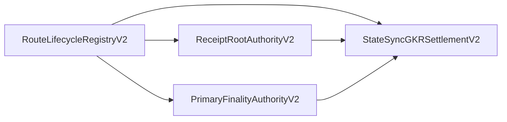

<!-- Hero variants follow the GitHub README column width: mobile below 440 px, medium from 440 to 680 px, desktop above. -->
<p align="center">
  <picture>
    <source media="(max-width: 505px), (min-width: 768px) and (max-width: 801px)" srcset="assets/brand/statesync-gkr-settlement-hero-mobile.svg">
    <source media="(max-width: 745px), (min-width: 768px) and (max-width: 1121px)" srcset="assets/brand/statesync-gkr-settlement-hero-medium.svg">
    
  </picture>
</p>

<p align="center">
  <a href="https://github.com/Oraclizer/statesync-gkr-settlement-evm/actions/workflows/ci.yml"></a>
  <a href="https://github.com/Oraclizer/statesync-gkr-settlement-evm/actions/workflows/ci.yml"></a>
  <a href="LICENSE-APACHE"></a>
</p>

# StateSync-GKR Settlement EVM

A deterministic Solidity reference for receipt-root authorization, route
lifecycle control, and one-leaf state-transition consumption in the
StateSync-GKR stack.

> **WARNING:** This is unaudited research software. The V2 contracts are not
> deployed or ready for production. Historical V1 Base Sepolia deployments are
> permanently abandoned and must not be reactivated.

## What is available

The V2 reference combines a lineage registry, a stable Settlement contract,
and separate Root and Primary-Finality Record (PFR) authorities. It checks
destination-bound EIP-712 authorizations, strict nonce and predecessor chains,
route lifecycle revisions, receipt membership, and replay-resistant transition
consumption. Rejected calls preserve state atomically through EVM reversion.

| Surface | Evidence and boundary |
| --- | --- |
| V2 contracts | Deterministic local tests, fuzzing, invariants and fixed vectors; no production deployment or independent security audit |
| V1 contracts | Historical Base Sepolia execution evidence; addresses and roles are permanently abandoned |
| CDK compatibility | Historical execution on an ephemeral stock Polygon CDK L2; no CDK L3, native proof, parent settlement or secondary-finality result |
| Toolchain | Foundry 1.7.1, exact solc 0.8.36 binary, Cancun, optimizer 200 and via-IR; no external Solidity dependency |
| Publication identity | Source code identified by Git commit; no Settlement release tag or stable API is claimed |

## Relationship to StateSync-GKR

The [StateSync-GKR prover v1.1.0](https://github.com/Oraclizer/statesync-gkr/releases/tag/v1.1.0)
owns the Rust proof path, Isabelle models, external proof identity and recorded
public inputs. Its archived source is
[DOI 10.5281/zenodo.23136385](https://doi.org/10.5281/zenodo.23136385).
This repository owns the Solidity reference consumers and lifecycle authorities.
Receipt roots are produced by the external verifier network and authorized for
consumption by separately configured quorums; the prover does not supply those
production authorities.

The preserved implementation source is
[`5efa0d65e73d07afe9f9a2dbc418e31f6247cbc7`](https://github.com/Oraclizer/statesync-gkr-settlement-evm/tree/5efa0d65e73d07afe9f9a2dbc418e31f6247cbc7).
The raw192 encoding and native one-leaf statement/root formulas agree with the
prover's v1.1 public inputs. The executable destination evidence uses earlier
historical fixtures, not a new v1.1 destination run. V2 Root/PFR authorization
is a separate epoch-2 EIP-712 contract. See the
[repository relationship and compatibility map](docs/REPOSITORY_RELATIONSHIP.md)
for the exact source, receipt and assumption boundaries.

## Quick start

Use Foundry `1.7.1` built from commit
`4072e48705af9d93e3c0f6e29e93b5e9a40caed8`, and the exact Solidity `0.8.36`
compiler. `foundry.toml` runs offline with auto-detection disabled, so fetch
the compiler once and verify it, exactly as CI does:

```sh
curl --fail --location --proto '=https' --tlsv1.2 \
  --output solc-0.8.36 \
  'https://binaries.soliditylang.org/linux-amd64/solc-linux-amd64-v0.8.36+commit.8a079791'
printf 'c8d35afdddc3cd2743ee88b8f25e0fecd16e2bdd5f2120f37e52cd9cc45ae0e6  solc-0.8.36\n' | sha256sum --check --strict
chmod 0755 solc-0.8.36
```

On macOS or Windows, download the matching platform build for
`v0.8.36+commit.8a079791` from the same official
`binaries.soliditylang.org` index and verify its published checksum, or run
`svm install 0.8.36` if you use svm.

Then run the same checks CI runs:

```sh
forge --version
sha256sum -c vectors/risc0-route-b-destination-policy-v1.json.sha256
sha256sum -c vectors/route-lifecycle-recovery-v1.json.sha256
forge fmt --check
forge build --offline --use ./solc-0.8.36
forge build --offline --use ./solc-0.8.36 --sizes --skip script
forge test --offline --use ./solc-0.8.36 --fuzz-seed 0x000102030405060708090a0b0c0d0e0f101112131415161718191a1b1c1d1e1f
```

The expected `forge --version` output contains both:

```text
forge Version: 1.7.1
Commit SHA: 4072e48705af9d93e3c0f6e29e93b5e9a40caed8
```

These checks use public, never-production signing fixtures and require no RPC,
fork, external wallet, broadcast, or deployment. The local CDK smoke script is
separate from ordinary tests; see its historical evidence and reproduction
boundary before using it.

## Contract ownership



The registry fixes one Settlement for a lineage and controls route lifecycle.
Root and PFR authorities bind their authorizations to that registry, Settlement,
route, epoch, revision, nonce, predecessor and validity window. The Settlement
owns route-independent economic nullifiers. It has no nullifier migration,
proxy upgrade or automatic successor. On-chain signer-address separation does
not establish independence of the people or custody systems behind the addresses.

## Historical evidence and non-claims

The preserved V1 records include Base Sepolia contract creation, root
registration, receipt consumption and negative-call observations. A published
skipped-nonce signature and missing destination binding make those epoch-1
addresses permanently evidence-only. They must not receive further signing,
registration, consumption or activation.

The V2 tests and local CDK L2 smoke are preserved separately. A smoke result
does not establish CDK L3 integration, a native execution proof, Base-parent
settlement, production custody, or secondary finality. No deployment or live
transaction is performed by publishing this source. Assumptions and operational
requirements are in [THREAT_MODEL_V2.md](docs/THREAT_MODEL_V2.md) and the
[predeployment checklist](docs/PREDEPLOYMENT_CHECKLIST.md).

## Repository map

- [V2 Settlement](src/StateSyncGKRSettlementV2.sol) and
  [lifecycle registry](src/RouteLifecycleRegistryV2.sol): lineage state and transition consumption.
- [V2 Root authority](src/ReceiptRootAuthorityV2.sol) and
  [PFR authority](src/PrimaryFinalityAuthorityV2.sol): destination-bound authorizations.
- [V1 encoding](docs/ENCODING.md) and [V2 encoding](docs/ENCODING_V2.md): fixed fields and hash formulas.
- [Vectors](vectors/README.md): content-bound reference inputs and checksums.
- [Local lifecycle drill](evidence/route-lifecycle-recovery-local-drill-2026-08-18.md): historical deterministic validation.
- [Base Sepolia evidence](evidence/base-sepolia-destination-enforcement-live-2026-08-15.md): abandoned V1 testnet instances.
- [CDK L2 smoke evidence](evidence/cdk-l2-smoke/README.md): bounded historical execution and its reproducibility manifest.
- [Runbook](docs/RUNBOOK.md) and [route lifecycle operations](docs/operations/route-lifecycle-recovery-v1.md): operational boundaries.
- [Foundry configuration](foundry.toml), [CI](.github/workflows/ci.yml) and [changelog](CHANGELOG.md): build and maintenance.

## Security, contributing and support

Report suspected vulnerabilities privately through [SECURITY.md](SECURITY.md),
never in a public issue. Tests, source review, historical execution evidence,
formal verification, security audits and production operation are distinct
claims. No independent security audit or production-readiness finding is claimed.

[CONTRIBUTING.md](CONTRIBUTING.md) describes the checks and accepted contributions.
[GOVERNANCE.md](GOVERNANCE.md) identifies the maintainer and decision process.
[SUPPORT.md](SUPPORT.md) and [CODE_OF_CONDUCT.md](CODE_OF_CONDUCT.md) define support
and participation boundaries.

## License and citation

Licensed under Apache-2.0 or MIT, at your option. See
[LICENSE-APACHE](LICENSE-APACHE), [LICENSE-MIT](LICENSE-MIT), and
[DISCLAIMER.md](DISCLAIMER.md) for the controlling terms and scope.
Use [CITATION.cff](CITATION.cff) and the exact Git commit when citing this
Settlement source. The prover's release and DOI identify the prover artifact,
not a release or security approval of this repository.
